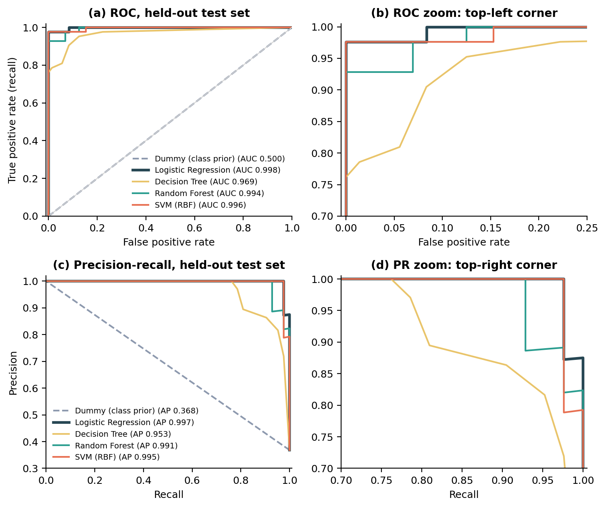
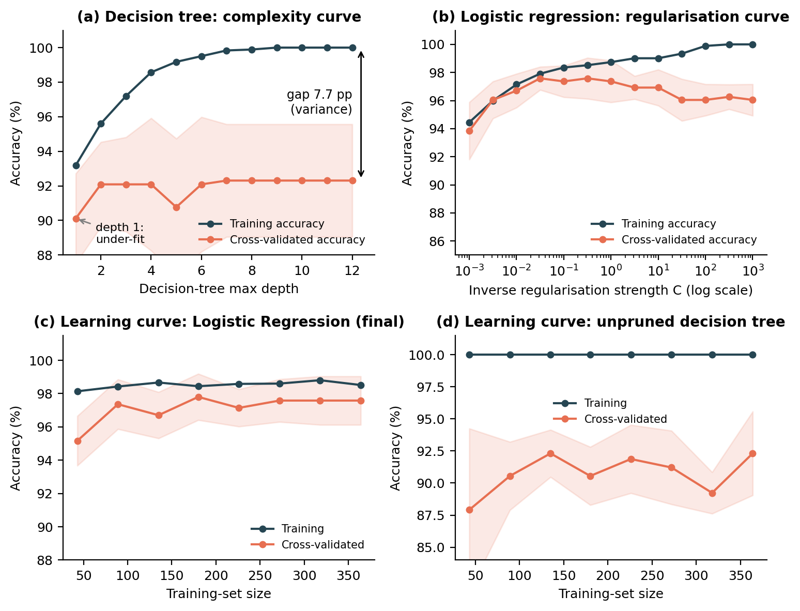

# Breast Tumour Classification — ML Model Development and Evaluation

Week 4 of the YuvaIntern Data Science Internship. A leakage-safe, nested-validation study that classifies breast masses as malignant or benign from 30 cell-nucleus measurements (Breast Cancer Wisconsin Diagnostic dataset, UCI).

> **Educational project — not a medical device.** Do not use this model to inform real diagnoses.

## Headline results

Five models were compared with nested 5×5 cross-validation on 455 training patients, then evaluated once on a locked 114-patient test set.

| Model | Nested-CV ROC-AUC | Test accuracy | Test recall | Test precision | Test ROC-AUC |
|---|---|---|---|---|---|
| Dummy (class prior) | 0.500 ± 0.000 | 63.2% | 0.0% | 0% | 0.500 |
| **Logistic Regression** | 0.994 ± 0.004 | 98.2% | 95.2% | 100% | 0.998 |
| Decision Tree | 0.948 ± 0.028 | 91.2% | 78.6% | 97% | 0.969 |
| Random Forest | 0.988 ± 0.007 | 97.4% | 92.9% | 100% | 0.994 |
| SVM (RBF) | 0.995 ± 0.006 | 96.5% | 90.5% | 100% | 0.996 |

The final model is **logistic regression (L2, C = 0.316)**: it is statistically tied with the SVM (difference smaller than one standard error), so the simpler, more interpretable model was chosen by the one-standard-error rule. Test-set counts are small (recall 40/42), so exact 95% intervals are reported in the full report.



## What makes this more than a "fit a model" notebook

- **Leakage control.** Split first, scale inside a `Pipeline`, tune with nested CV, choose the decision threshold on out-of-fold training data, touch the test set once.
- **Duplicate experiment.** The data contain no duplicates, so copies were injected to measure the damage: at 30% duplication a naive split inflated an unpruned tree's accuracy by 2.6 points.
- **Collinearity experiment.** 21 of 435 feature pairs have |r| > 0.9 (VIF up to 3,806). Prediction is unaffected by pruning, but unregularised coefficients flip sign in 32–45% of bootstraps; tuned L2 does not.
- **Threshold analysis.** Four operating points compared; the F2-optimal threshold (0.40) recovers one of two test misses for one false alarm.
- **Error analysis.** A human-review band (0.2 < P < 0.8) holds 7.7% of patients but 64% of cross-validated errors.
- **Over/under-fitting diagnostics.** Complexity curves, regularisation curve and learning curves.



## Repository structure

```
.
├── README.md
├── LICENSE
├── requirements.txt
├── src/
│   └── week4_ml_pipeline.py     # full pipeline: audit → EDA → models → evaluation → figures
├── figures/                     # 11 PNG figures used in the report
├── results/
│   ├── results.json             # every metric quoted in the report
│   └── extras.json              # operating points and review-band numbers
└── report/
    └── Week4_ML_Model_Report.docx   # full 20-page write-up
```

## Reproduce

```bash
git clone <your-repo-url>
cd <your-repo-name>
python -m venv .venv && source .venv/bin/activate      # Windows: .venv\Scripts\activate
pip install -r requirements.txt
python src/week4_ml_pipeline.py
```

- Runs in about 3–4 minutes on a single CPU core.
- All randomness is seeded (seed 42), so the metrics in `results/` regenerate identically with the pinned library versions.
- The dataset ships with scikit-learn (`load_breast_cancer`), so no download or API key is needed. Note that scikit-learn codes *malignant* as 0; the script recodes it so malignant = 1 (the positive class).

## Data

Breast Cancer Wisconsin (Diagnostic) — created by W. N. Street, W. H. Wolberg and O. L. Mangasarian, University of Wisconsin; hosted by the UCI Machine Learning Repository. 569 patients, 30 numeric features (mean, standard error and worst value of ten nucleus measurements), 212 malignant / 357 benign.

## Limitations

Single-institution research data; small test set; no demographic variables; precision is prevalence-dependent (this sample is 37% malignant). See Sections 7–9 of the report.

## License

MIT — see [LICENSE](LICENSE). The dataset remains subject to its original UCI terms.
